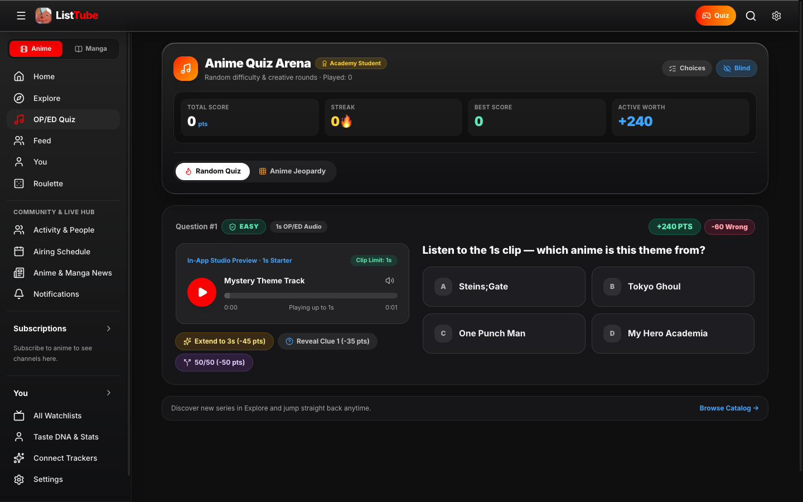
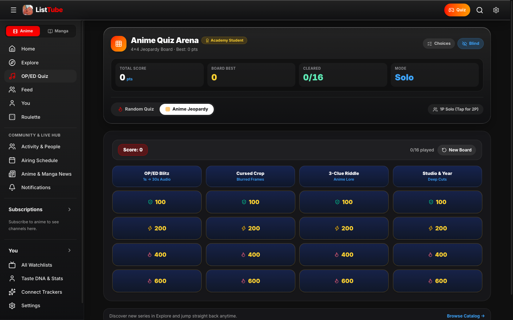
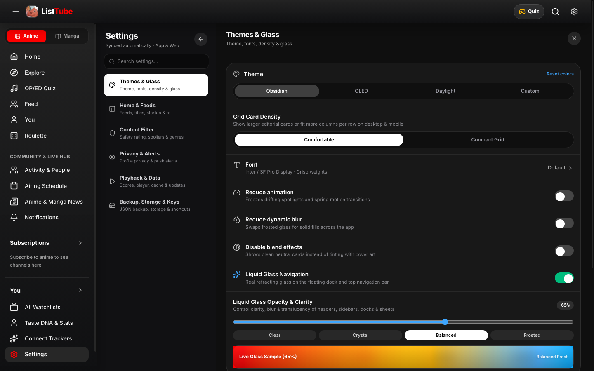
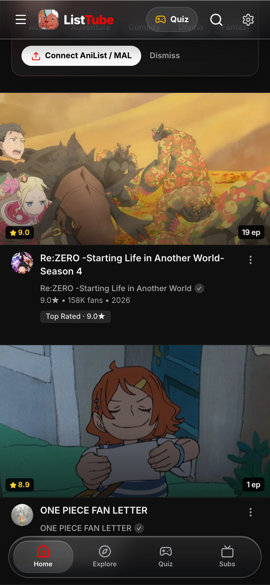
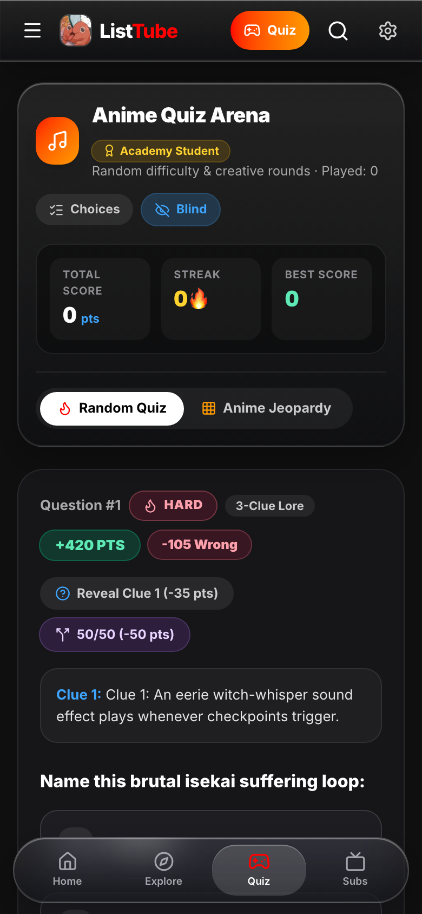

<div align="center">


# ListTube (`v1.3.1`)

**A YouTube-Inspired Anime & Manga Tracker, Franchise Channel Hub, Quiz Arena, and 2-Way Sync Platform**

Built with React 18, TypeScript, Tailwind CSS v4, Supabase Edge Functions, and Capacitor Android — combining YouTube's clean mobile navigation and auto-hiding fullscreen chrome with transparent **Apple Liquid Glass** surfaces, BitChord-inspired theme customization, an **Anime Quiz & Jeopardy Arena**, a `1,950`-title offline starter catalog, **native in-app APK auto-updates**, and 2-way **AniList**, **MyAnimeList**, **Google**, **Comix**, and **Mihon** tracking.

[](https://github.com/harshtheotaku/ListTube/releases/latest)
[](https://listtube.vercel.app/)
[](https://github.com/harshtheotaku/ListTube/releases/latest/download/ListTube-android.apk)
[](https://obtainium.imranr.dev/)
[](https://github.com/harshtheotaku/ListTube/actions/workflows/build.yml)
[](LICENSE)

[**Launch Web App**](https://listtube.vercel.app/) · [**GitHub Pages Mirror**](https://harshtheotaku.github.io/ListTube/) · [**Download `ListTube-android.apk`**](https://github.com/harshtheotaku/ListTube/releases/latest/download/ListTube-android.apk) · [**All Releases**](https://github.com/harshtheotaku/ListTube/releases) · [**Report an Issue**](https://github.com/harshtheotaku/ListTube/issues)

</div>

---

## What's New in `v1.3.1`

- **Transparent Apple Liquid Glass & Full-Screen Settings (`/settings`):**
  - Truly transparent refractive **Liquid Glass** across headers, floating docks, sticky filter rails, sidebars, and modal sheets with live **Opacity & Clarity** slider (`Clear`, `Crystal`, `Balanced`, `Frosted`) and live preview strip.
  - Dedicated edge-to-edge **full-screen Settings page** (with web-only shortcuts automatically hidden inside the Android app), **Obsidian / OLED / Daylight / Custom Hex** themes + 12 swatches, **4 bundled offline fonts** (`Inter`, `Plus Jakarta Sans`, `Newsreader`, `JetBrains Mono`), and performance toggles (**Reduce animation**, **Reduce dynamic blur**, **Disable blend effects**).
- **Direct Native In-App APK Auto-Updater (Zero GitHub Visits):**
  - Download and install signed Android APK releases straight inside **Settings → Playback & Data → Direct In-App Auto-Updater** with live `%` progress bar, **Download Update** & **Install Update In-App** buttons, automatic `Allow from this source` permission handling, and background auto-update checks (`1.3.1`, `1.3.2`, `1.3.3`…).
- **Anime Quiz Arena (`/quiz`) in Navigation Bar & Sidebar:**
  - Two focused modes — **Random Quiz** and **4×4 Anime Jeopardy** (1P Solo & 2P Versus with Daily Double 2×).
  - **1s → 3s → 10s → 30s** precision OP/ED studio audio progression, randomized **Easy / Medium / Hard** badges per question, **negative points** on wrong answers, high-visibility **Points Scoreboard**, **50/50 lifeline**, forgiving **Type-In** mode, and creative rounds (**Emoji Plot Decoder**, **Iconic Quotes**, **Odd One Out**, **Stat Clash**, **Cursed Visual Crops**, **3-Clue Lore Riddles**, and **Studio & Year**).
- **Standalone Tracker Parity & Browser Auto-Tracker:**
  - Native **ListTube Community Scores**, **Episode Check-In Ratings & Spoiler Reactions**, **Global Rankings** (`/stats`, `/rankings`), **Friend List Diff**, **MyAnimeList `.xml` Export**, and a scoped **`lt_...` Tracker API (`/v1`)** powering the included **`companion-extension/`** Chrome/Edge auto-scrobbler.
- **Streamlined Navigation Bar & Sidebar:**
  - Clean 4-item floating mobile dock (**Home**, **Explore**, **Quiz**, **Subs**) with scroll-to-fullscreen auto-hiding chrome, while **Feed** and **You** live directly at the top of the **Sidebar** alongside **OP/ED Quiz** and **Roulette**.

---

## Key Features

- **Franchise Channel Metaphor (`ChannelView.tsx`, `franchise.ts`):** Every series acts as a dedicated Channel featuring **Oldest / Newest / All** watch order (organizing OVAs & specials), **Similar Anime/Manga**, **From This Studio**, and live **About → Broadcast & Release Schedule** countdowns.
- **Personalized Discovery & Trackers (`HomeView.tsx`, `ExploreView.tsx`, `recommender.ts`):** Blends AniList community recommendations, MAL `/userrecs` votes (with prequel inheritance), studio/genre affinity vectors, **Content Safety & Blocked Genres**, **Drop Predictor**, **Watch Order Guide**, and **Filler/Manga Canon Guide**.
- **2-Way Multi-Platform Sync & Importers (`TrackersModal.tsx`, `backupImport.ts`):** Sync with **Google Cloud Sync**, **AniList OAuth**, and **MyAnimeList OAuth** with **3-Way Sync Diff**, or import **Mihon / Tachiyomi** (`.tachibk`, `.proto.gz`, `.json`), **Comix** (`.csv`, `.json`), **MAL** (`.xml`), and **ListTube** (`.json`).
- **Rich Personal Analytics & Utilities (`YouView.tsx`, `ListView.tsx`):** Bulk **Spreadsheet Table View**, **3×3 Collage & Tier List PNG Maker**, **ListTube Wrapped** shareable card, **Pacing Goal & Remaining Volume Calculator**, **26-Week Activity Heatmap**, and **Taste DNA** stats.
- **Schedules, News & Social Feed (`ScheduleView.tsx`, `NewsView.tsx`, `FeedView.tsx`):** 7-day **Anime airing countdowns**, **Manga/Manhwa release tracking**, illustrated MAL & ANN news, **Group Watch Picker**, and community reviews with **Taste Affinity %**.
- **Offline-First Signed Android APK (`~5.7 MB`):** Bundled `1,950`-title offline starter catalog, offline subscribed cover caching, local Android airing alarms, guarded in-app `WebView` with popup/ad shielding, and instant cold-start IndexedDB hydration.

---

## Visual Tour

### Desktop Experience


<p align="center">
  
  &nbsp;
  
</p>

<p align="center">
  
  &nbsp;
  
</p>

<p align="center">
  
</p>

### Mobile & Android App Experience

<p align="center">
  
  &nbsp;&nbsp;
  
  &nbsp;&nbsp;
  
</p>

---

## Quick Download & Install

### Android App (`ListTube-android.apk`) — Direct In-App Auto-Updates (\$0)
1. **First-Time Install:** Download [**`ListTube-android.apk`**](https://github.com/harshtheotaku/ListTube/releases/latest/download/ListTube-android.apk) (Android 7.0+) and tap **Install**.
2. **Direct In-App Auto-Updates (Built-In):** Open **Settings → Playback & Data → Direct In-App Auto-Updater** to toggle automatic updates, or tap **Download Update** and **Install Update In-App** anytime without visiting GitHub.
3. **Obtainium Support (Optional):** Add `https://github.com/harshtheotaku/ListTube` inside [Obtainium](https://obtainium.imranr.dev/) if you prefer external release tracking.

### Web App
- Primary deployment: **https://listtube.vercel.app**
- Secondary GitHub Pages mirror: **https://harshtheotaku.github.io/ListTube/**

### Browser Auto-Tracker Companion (`companion-extension/`)
- Load the unpacked `companion-extension/` folder in Chrome, Brave, or Edge, generate a scoped `lt_...` key in **Settings → Backup, Storage & Keys**, and automatically scrobble episodes back to ListTube.

### Test Live on Laptop
1. **Virtual Android Phone Window (`Launch Android Phone.command` / `npm run android:emulator`):** Boots the Pixel Android virtual phone on macOS, builds ListTube, installs it, and launches the app.
2. **Instant Browser Hot-Reload (`Start ListTube on Laptop.command` / `npm run laptop`):** Launches Vite dev server at **`http://localhost:5173`** with `<200ms` HMR.
3. **Built-in Phone Bezel Preview (`Cmd+K`):** Press **`Cmd+K`** → **"Open 390px Phone Simulator"** on desktop web.

<details>
<summary>Developer Setup & Android APK Build Instructions</summary>

```bash
git clone https://github.com/harshtheotaku/ListTube.git
cd ListTube
npm install
npm test        # Vitest unit tests (10 suites, 30 tests)
npm run build   # TypeScript check + Vite production bundle
```

Build and install signed Android APK locally:
```bash
npx cap sync android
cd android
./gradlew assembleRelease
adb install -r app/build/outputs/apk/release/app-release.apk
```

</details>

---

## Architecture

```text
listtube/
├── .github/workflows/
│   ├── build.yml                    # Builds & signs ListTube-android.apk and publishes v<pkg.version> release
│   └── deploy-pages.yml             # Deploys Web SPA bundle to GitHub Pages
├── android/                         # Capacitor Android project (native in-app APK updater, guarded WebView, alarms)
├── companion-extension/             # Chrome/Edge auto-scrobbler extension using /v1 Tracker API
├── docs/screenshots/                # Visual tour screenshots (desktop & mobile)
├── public/                          # PWA manifest, Pochita icons & offline service worker
├── src/
│   ├── data/offlineStarter.json     # Curated 1,950-title offline starter catalog
│   ├── components/                  # React views, Transparent Liquid Glass bars, Full-Screen Settings & Quiz Arena
│   └── services/                    # AniList/Jikan/MAL clients, themeQuiz, appUpdater, backupImport, outbox, syncDiff
├── supabase/functions/listtube-api/ # Deno Edge Gateway (/v1 Tracker API, /stats, /rankings, OAuth, /userrecs)
├── api/og.ts                        # Vercel Edge OpenGraph social preview handler
└── capacitor.config.ts              # Capacitor Android configuration
```

---

## License

Released under the [MIT License](LICENSE).
