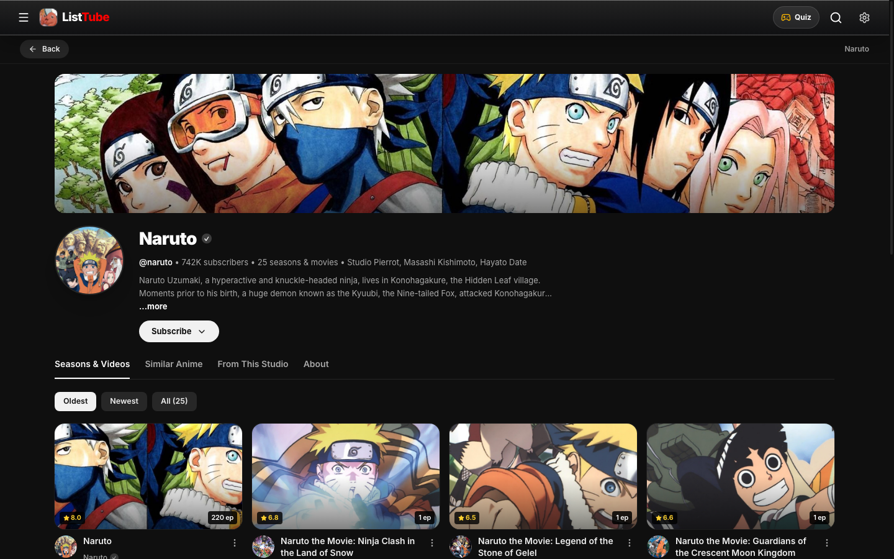
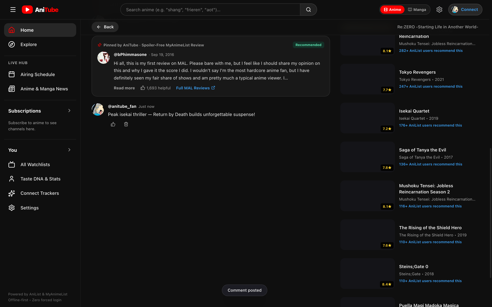
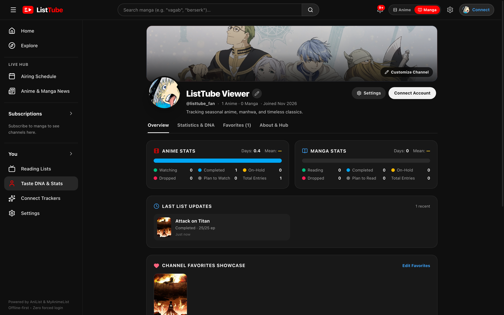
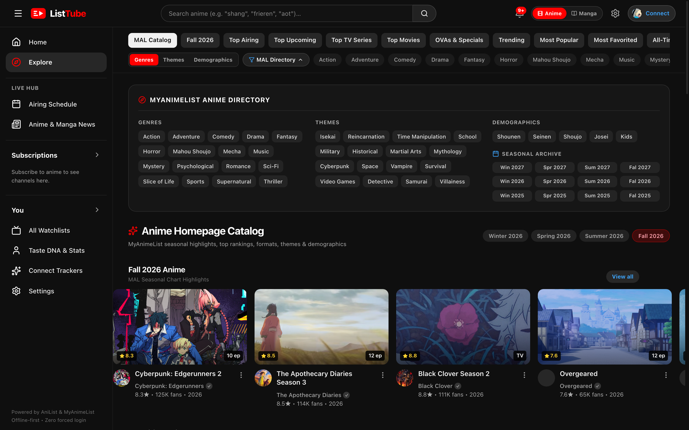
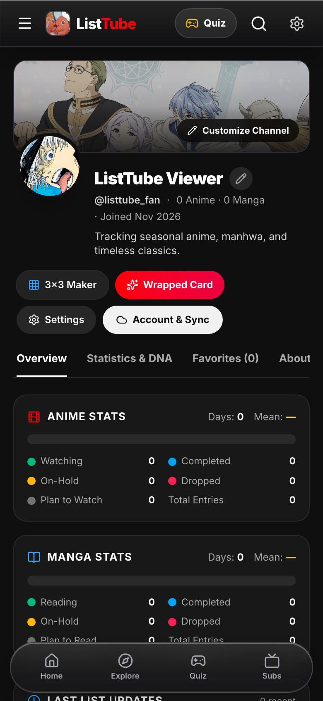

<div align="center">

# ListTube

**A YouTube-Inspired Anime & Manga Discovery, Franchise Channel, and Recommendation App**

Built with React, TypeScript, Tailwind CSS v4, and Capacitor Android — bringing YouTube's dark `#0F0F0F` AMOLED interface, infinite discovery feeds, franchise channels, and community-backed recommendation algorithms to Web & Android with zero forced login.

[](https://listtube.vercel.app/)
[](https://github.com/harshtheotaku/ListTube/releases/latest/download/ListTube-android.apk)
[](https://github.com/harshtheotaku/ListTube/actions/workflows/build.yml)
[](https://github.com/harshtheotaku/ListTube/actions/workflows/deploy-pages.yml)
[](LICENSE)

[**Launch Web App (`listtube.vercel.app`)**](https://listtube.vercel.app/) · [**Download Android APK**](https://github.com/harshtheotaku/ListTube/releases/latest/download/ListTube-android.apk) · [**Report an Issue**](https://github.com/harshtheotaku/ListTube/issues)

</div>

---

## Visual Tour

### Desktop Web — Infinite 16:9 Home Feed
Pure `#0F0F0F` AMOLED theme with category filter chips, infinite scrolling personalized recommendations, verified anime franchise channels, and crisp 16:9 artwork framing.


### Anime Franchise Channels (All Seasons, Similar Anime & Studio Tab)
Every anime & manga series acts like a dedicated YouTube Channel — complete with banner art, `@handle`, subscriber count, bio `...more`, 5-list Subscribe picker, **Oldest** / **Newest** / **All** watch order filters (tucking OVAs, fillers & mini specials into **All**), **Similar Anime**, and a **From This Studio** tab.



### Watch Page, Official Link & Direct Community Destinations
On-demand trailer playback (with optional **Auto-Play Trailers** setting), inline expandable synopsis, 5-list subscription & Favorites buttons, **Up Next & Similar** community recommendations (AniList + MyAnimeList `/userrecs` + Season 1 prequel inheritance + Reddit consensus pairings), a single **English official** streaming/reading destination, direct **Re Anime**, **KotoPlay**, and **AnimePahe** links for anime, plus direct **Comix.to** and **Kagane** reader links for manga.


### YouTube Comments & Full Pinned Spoiler-Free MAL Reviews
Write permanent device-local notes & comments on any anime or manga, with the **complete spoiler-free MyAnimeList review pinned right at the top** so you can read the full review without leaving the app.



### Custom Channel Profile, Reviews & Live Community Feed
Tap **Customize Channel** in the **You** tab to pick panoramic anime banners or upload your own, set your avatar (custom photo or global AniList character search PFPs), edit your bio & `@handle`, feature Favorite Anime/Manga/Characters, inspect MAL-style dual **Anime & Manga Statistics**, **Score Distribution** across 4 rating scales (0.5 decimals, 10-pt, 100-pt, 5-star), and browse the global **Community Activity & People** feed with Pearson **Taste Affinity %**.



### MAL Homepage Catalog, Multi-Axis Filters & Notifications
Explore features MyAnimeList's full homepage catalog (Seasonal Chart, Top Airing, Upcoming, TV/Movies/Manhwa/Novels), a **Multi-Axis Combinable Filter Drawer** (multiple genres + themes + year range + format + status + origin + min score + exclude my list), and top **Bell** alerts on airing episodes, franchise sequels, and MAL news.




### Dedicated Manga Mode (`4:5` Portrait Covers & 2-Column Mobile Grid)
Switch seamlessly between **Anime (`16:9`)** and **Manga (`4:5` portrait covers)** with separate watch/read progress, genres, and recommendation profiles. On Android/mobile, Manga automatically lays out **2 cards per row** for fast browsing.

<p align="center">
  
  &nbsp;&nbsp;
  
  &nbsp;&nbsp;
  
</p>

<details>
<summary>Desktop Manga 5-Column Portrait Grid</summary>


</details>

---

## Key Features

- **Franchise Channel Metaphor (`ChannelView` & `franchise.ts`):**
  - Channel names on cards and watch pages represent the **Anime/Manga franchise**, grouping prequels, sequels, OVAs, movies, and spin-offs into one unified channel with **Oldest / Newest / All** watch order (OVAs, fillers & mini specials organized into **All**), **Similar Anime**, **From This Studio**, and **About** tabs.
- **Community-Backed Recommendation Engine (`recommender.ts`):**
  - Blends **AniList Community Recommendations**, **MyAnimeList `/userrecs` fan votes** (with Season 1 prequel inheritance for multi-season franchises), **Franchise Relations**, and **Curated Reddit / Editorial affinity graphs**.
  - Multi-dimensional taste vector weighting niche tags, studios, genres, and formats paired with MMR diversification, individualized anchor rotation on every open & refresh, and infinite `IntersectionObserver` pagination.
- **Per-Tab Independent Search Bars & Smart Partial Match (`search.ts`):**
  - Every tab (`Home`, `Explore`, `Subscriptions`, `Schedule`, `News`, `You`) retains its **own independent search query** instead of leaking one global search term across tabs.
  - Supports instant partial prefixes and aliases (`"shang"` -> *Shangri-La Frontier*, `"aot"`, `"jjk"`, `"fmab"`) powered by MAL prefix, Shikimori, and AniList batch hydration.
- **Mobile-First Navigation & Full-Width Mobile Search (`TopBar.tsx`, `YouView.tsx`):**
  - Mobile top bar keeps **only the ListTube logo and a wide search bar**; Anime/Manga mode switch, **Schedule**, **News**, **Connect Account**, and **Settings** live cleanly in the **You** hub and bottom bar.
- **Live Broadcast Schedule & Illustrated News (`ScheduleView.tsx`, `NewsView.tsx`):**
  - 7-day official airing countdowns powered by AniList plus illustrated industry news from MyAnimeList News and Anime News Network.
- **Google Login, Username Import & Bidirectional 2-Way OAuth (`supabase.ts`, `cloudSync.ts`, `trackers.ts`):**
  - Works immediately with **zero forced login** while offering 1-tap **Google Sign-In** (cross-device watchlist, likes, profile, reviews, follows & comments backed by Supabase Postgres RLS) plus **AniList & MyAnimeList username import / 2-Way OAuth (with PKCE)** that saves AND deletes status, progress, volumes, rewatches, start/finish dates, notes, and privacy settings.
- **Full Encyclopedia Watch Pages (`DetailView.tsx`):**
  - Displays full **Characters & JP/EN Voice Actors**, **Production Staff / Authors**, **Opening & Ending Theme Songs**, interactive **Community Score & Status Distribution** histograms, public **User Reviews** with sub-scores & helpful voting, **Episode Discussions**, and threaded replies.
- **Postgres L2 Edge Cache Gateway (`supabase/functions/listtube-api`):**
  - Routes AniList GraphQL, CORS-free MyAnimeList `/userrecs` & spoiler-free `/reviews`, ANN/MAL News, and canonical `reader_catalog` matching (`89,976+` indexed `Comix.to` direct series URLs) through a shared Supabase Edge Cache (`HIT`/`STALE` rate-limit protection).
- **Pull-to-Refresh Recommendations & Synced Comments (`CommentsSection.tsx`, `reviews.ts`):**
  - Pulling down / scrolling upward at the top of the Home feed refreshes recommendations with fresh unseen picks instead of repeating top cards.
  - Persistent YouTube-style comments saved locally with a pinned spoiler-free review fetched from MyAnimeList (`reviews.ts`) and customizable character avatars (`profile.ts`).
- **Native Android Back Navigation & Viewport Lock (`MainActivity.java`):**
  - Android hardware/gesture back steps backward cleanly through modals, watch pages, franchise channels, and tabs before exiting on Home; WebView pinch/overview zoom is locked at native 1.0x mobile scale.

---

## Quick Download & Install

### Android App (No Setup Needed)
1. **Download the APK:** Tap [**Download ListTube-android.apk**](https://github.com/harshtheotaku/ListTube/releases/latest/download/ListTube-android.apk) on your Android phone (Android 7.0+).
2. **Open & Install:** Tap the downloaded `.apk` file and choose **Install** (allow "Install unknown apps" for your browser/file manager if prompted).
3. **Launch ListTube:** Open the app — your profile, character PFP, comments, and recommendations work immediately with zero login required.

### Web App (Desktop & Mobile Browser)
Open the live hosted website directly in any browser:
> **https://listtube.vercel.app** *(also reachable via `https://listtube-in.vercel.app` & `https://harshtheotaku-listtube.vercel.app`, with a secondary GitHub Pages mirror at `https://harshtheotaku.github.io/ListTube/`)*

*(Runs on Vercel Edge + [`api/og.ts`](api/og.ts) for clean `/anime/...` routes, dynamic OpenGraph social cards, and desktop/mobile PWA Add-to-Home-Screen.)*

<details>
<summary>Developer Build, USB Install & Local Self-Hosting</summary>

#### Prerequisites
- Node.js 22+, Java 21, Android SDK (`ANDROID_HOME`) for Android builds

#### Run Locally (`http://localhost:5173`)
```bash
git clone https://github.com/harshtheotaku/ListTube.git
cd ListTube
npm install
npm run dev
```

#### Build & Install Android APK via USB Debugging (`adb`)
```bash
npm run build
npx cap sync android
cd android
./gradlew assembleRelease
adb install -r app/build/outputs/apk/release/app-release.apk
```

- **Vercel Hosting:** Pre-configured with [`vercel.json`](vercel.json) rewrites for `/proxy/mal/*` and `/proxy/ann/*`.
- **GitHub Pages Hosting:** Built via [`.github/workflows/deploy-pages.yml`](.github/workflows/deploy-pages.yml) and powered server-side by our Supabase Edge Gateway ([`listtube-api`](supabase/functions/listtube-api/index.ts)) so MAL reviews, `/userrecs`, news, and direct manga reader links run CORS-free on static hosting.

</details>

---

## Architecture

```text
listtube/
├── .github/workflows/
│   ├── build.yml                # CI: builds TypeScript + Vite bundle & signed Release APK
│   └── deploy-pages.yml         # CD: builds and deploys live website to GitHub Pages
├── android/                     # Capacitor Android native wrapper (com.listtube.app)
├── docs/screenshots/            # Promo captures from Web & Mobile
├── src/
│   ├── components/
│   │   ├── AnimeCard.tsx        # 16:9 Anime & 3-panel 4:5 Manga card + franchise channel trigger
│   │   ├── BottomNav.tsx        # Mobile 5-tab navigation bar
│   │   ├── ChannelView.tsx      # Franchise channel (Oldest/Newest/All, Similar Anime, From This Studio)
│   │   ├── CommentsSection.tsx  # Persistent comments + full pinned spoiler-free MAL review
│   │   ├── DetailView.tsx       # Trailer watch page, 5-list Subscribe, Up Next recommendations
│   │   ├── ExploreView.tsx      # Full MAL Anime & Manga Homepage Catalog, Charts & Directory
│   │   ├── FeedView.tsx         # Live AniList-style global/following Activity Feed & People Affinity Directory
│   │   ├── HomeView.tsx         # Infinite "For You" feed, Anime|Manga switch & pull-to-refresh
│   │   ├── ListTubeLogo.tsx     # Geometric red ListTube checklist + play badge logo
│   │   ├── ListView.tsx         # Subscriptions manager, dates/volumes/rewatches/notes & 4 scoring scales
│   │   ├── NewsView.tsx         # Illustrated anime & manga news feed
│   │   ├── NotificationsModal.tsx # MAL-style Airing Episodes, Sequel & News notification center
│   │   ├── ProfileModal.tsx     # Channel branding, bio, global character search & favorites editor
│   │   ├── ScheduleView.tsx     # 7-day live airing countdowns
│   │   ├── SettingsModal.tsx    # Auto-play, scoring scale selector, community links & IndexedDB cache
│   │   ├── Shelf.tsx            # Horizontal recommendation shelves
│   │   ├── Sidebar.tsx          # Collapsible YouTube navigation & subscribed channels
│   │   ├── Skeleton.tsx         # Responsive 16:9 & 4:5 loading skeletons
│   │   ├── TopBar.tsx           # Per-tab search bar, MAL notifications bell & desktop controls
│   │   ├── TrackersModal.tsx    # Google Login + AniList/MAL Username & OAuth PKCE 2-way sync
│   │   ├── UserProfileModal.tsx # Public @handle channel page & Pearson taste affinity %
│   │   └── YouView.tsx          # YouTube × MAL Channel hub (Stats bar, Favorites, Account Hub)
│   └── services/
│       ├── anilist.ts           # AniList GraphQL + Characters/Staff/Stats + Multi-Axis filter client
│       ├── animeStore.ts        # IndexedDB-backed media store (up to 10,000 cached records)
│       ├── cloudSync.ts         # Google Auth, Postgres cloud sync, Activity publishing & 2-way OAuth write-back
│       ├── comments.ts          # Per-title & per-episode threaded discussions
│       ├── community.ts         # Public reviews, helpful votes, activity feed, following & affinity
│       ├── franchise.ts         # Franchise name normalization & multi-season relation walker
│       ├── jikan.ts             # Jikan + Edge OP/ED themes & MAL fallback client
│       ├── library.ts           # Offline-first reactive persistence (progress, dates, volumes, likes, decimal scores)
│       ├── mediaDb.ts           # IndexedDB persistence layer for large metadata catalogs
│       ├── news.ts              # Edge-proxied MAL News & ANN RSS aggregator
│       ├── notifications.ts     # Airing schedule, franchise sequel & news notification engine
│       ├── platform.ts          # Runtime environment resolver (Capacitor / Proxy / Static Pages)
│       ├── profile.ts           # User profile store + 16 character PFPs + global character picks
│       ├── recommender.ts       # Multi-source community vector, refresh rotation & MMR engine
│       ├── reviews.ts           # CORS-free spoiler-free MyAnimeList pinned review fetcher
│       ├── scoring.ts           # Multi-scale scoring (0.5 / 10 / 100 / 5★) & Pearson taste affinity
│       ├── search.ts            # Partial-word & acronym smart search engine
│       ├── settings.ts          # User preference persistence
│       ├── supabase.ts          # Supabase PKCE client + Edge Gateway helpers
│       └── trackers.ts          # AniList & MAL Username / OAuth PKCE / XML importers
├── api/og.ts                    # Vercel serverless dynamic OpenGraph / share preview function
├── public/404.html              # GitHub Pages SPA History fallback
├── supabase/
│   └── functions/
│       └── listtube-api/        # Supabase Edge Function (L2 cache, OAuth, MAL themes/reviews, /share OG)
├── capacitor.config.ts          # CapacitorHttp enabled for native CORS-free networking
├── vercel.json                  # Production proxy & /share OG rewrites
└── vite.config.ts               # Chunk-split bundle & GitHub Pages subpath configuration
```

---

## Tech Stack

- **Frontend:** React 18, TypeScript, Tailwind CSS v4, Lucide Icons, IndexedDB
- **Backend & Cloud Sync:** Supabase (Postgres 17 + pg_trgm, Google PKCE Auth, Storage, Deno Edge Functions)
- **Build & Tooling:** Vite 8 (lazy route splitting), Vitest + jsdom
- **Mobile Runtime:** Capacitor 8 Android (`CapacitorHttp` native networking)
- **APIs & Metadata:** AniList GraphQL, MyAnimeList, Shikimori, Anime News Network RSS, Jikan

---

## License

Released under the [MIT License](LICENSE).
