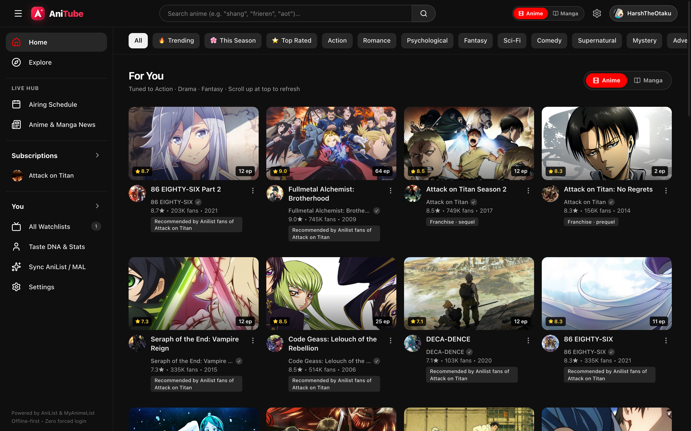
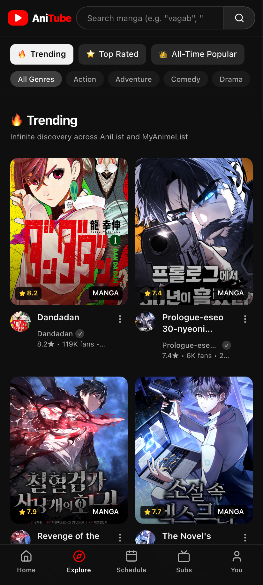

<div align="center">


# ListTube (`v1.2.0-beta.1`)

**A YouTube-Inspired Anime & Manga Discovery, Franchise Channel, and 2-Way Sync Platform**

Built with React 18, TypeScript, Tailwind CSS v4, Supabase, and Capacitor Android — combining YouTube's clean mobile navigation and auto-hiding fullscreen chrome with Apple Liquid Glass surfaces, BitChord-inspired theme customization, a `1,950`-title offline starter catalog, and 2-way **AniList**, **MyAnimeList**, **Google**, **Comix**, and **Mihon** tracking.

[](https://github.com/harshtheotaku/ListTube/releases)
[](https://listtube.vercel.app/)
[](https://github.com/harshtheotaku/ListTube/releases/latest/download/ListTube-android.apk)
[](https://github.com/harshtheotaku/ListTube/actions/workflows/build.yml)
[](LICENSE)

[**Launch Web App**](https://listtube.vercel.app/) · [**Download `ListTube-android.apk`**](https://github.com/harshtheotaku/ListTube/releases/latest/download/ListTube-android.apk) · [**Report an Issue**](https://github.com/harshtheotaku/ListTube/issues)

</div>

---

## What's New in `v1.2.0-beta.1` (Beta)

- **Clean YouTube Mobile UX & Scroll Fullscreen:** Minimal top bar with expandable multi-entity search icon (`🔍`), YouTube-clean Home feed grid, user avatar in the floating `You` tab, and **scroll-to-fullscreen auto-hiding header & dock** (scroll down to hide, scroll up to reveal).
- **Apple Liquid Glass & Appearance Engine:** Toggleable frosted **Liquid Glass** dock & header, **Obsidian / OLED / Daylight / Custom Hex** themes + 12 swatches, **4 bundled offline fonts** (`Inter`, `Plus Jakarta Sans`, `Newsreader`, `JetBrains Mono`), plus **Reduce animation**, **Reduce dynamic blur**, and **Disable blend effects** performance toggles.
- **Morphe Enhancer & Direct Read/Watch Destinations:** **Enhanced Ambient Mode** (with dim-on-scroll), desktop **Theater Mode**, unified **Watch on KotoPlay** / **Read on Comix** direct CTA buttons matching the recommended destination cards, and a **Link Browser selector** (`External` default, `Ask Each Time`, or `Built-in Guarded Browser` with popup/redirect shielding in Android `WebView`).
- **Backup Importers & Multi-Tracker Sync:** Import **Mihon / Tachiyomi** (`.tachibk`, `.proto.gz`, `.json`), **Comix** (`.csv`, `.json`), **MAL** (`.xml`), and **ListTube** (`.json`) directly inside **Account & Sync**, alongside **Google Cloud Sync** and 2-way **AniList** & **MAL** OAuth with **3-Way Sync Diff**.
- **Personal Utilities:** **ListTube Wrapped** shareable PNG summary card, interactive **OP/ED Music Quiz**, per-title **Pacing Goal & Remaining Volume Calculator**, **Manga Release Schedule**, and live **Broadcast & Release Schedule** in every Franchise Channel's **About** tab.
- **Offline-First `7.5 MB` Signed Android APK:** Bundled **`1,950`-title** offline starter catalog and uncompressed local variable fonts (`noCompress` in Gradle) for instant offline search and zero-wait Android WebView startup + Pochita icon & launch splash animation.

---

## Key Features

- **Franchise Channel Metaphor (`ChannelView.tsx`, `franchise.ts`):** Every series acts as a dedicated Channel featuring **Oldest / Newest / All** watch order (organizing OVAs & specials), **Similar Anime/Manga**, **From This Studio**, and live **About → Broadcast & Release Schedule** countdowns.
- **Personalized Discovery & Filters (`HomeView.tsx`, `ExploreView.tsx`, `recommender.ts`):** Blends AniList community recommendations, MAL `/userrecs` votes (with prequel inheritance), studio/genre affinity vectors, **Content Safety & Blocked Genres filters**, **Drop Predictor**, **Watch Order Guide**, and **Filler/Manga Canon Guide**.
- **Schedules & Live Hub (`ScheduleView.tsx`, `NewsView.tsx`, `FeedView.tsx`):** Supports both **Anime 7-day airing countdowns** and **Manga weekly/ongoing/manhwa release tracking**, illustrated MAL & ANN news, and social reviews/activity feeds with Pearson **Taste Affinity %**.
- **Global Search & Entity Pages (`TopBar.tsx`, `EntityView.tsx`):** Searches Anime, Manga, Manhwa, Characters, Voice Actors/Staff (with Wikipedia summaries & MAL search integration), and public profiles.
- **Offline Queue & Dual Storage (`animeStore.ts`, `writebackOutbox.ts`):** IndexedDB storage caches thousands of titles locally while queueing offline list edits for automatic replay when back online.

---

## Visual Tour



<p align="center">
  
  &nbsp;
  
</p>

<p align="center">
  
  &nbsp;&nbsp;
  
  &nbsp;&nbsp;
  
</p>

---

## Quick Download & Install

### Android App (`ListTube-android.apk`)
1. Download [**`ListTube-android.apk`**](https://github.com/harshtheotaku/ListTube/releases/latest/download/ListTube-android.apk) (Android 7.0+).
2. Open the APK file and tap **Install** (enable "Install unknown apps" if prompted).
3. Launch **ListTube** — offline catalog search, themes, tracking, and Comix/Mihon backup import work immediately without signing in.

### Web App
- Primary deployment: **https://listtube.vercel.app**
- Secondary GitHub Pages mirror: **https://harshtheotaku.github.io/ListTube/**

<details>
<summary>Developer Setup & Android APK Build Instructions</summary>

```bash
git clone https://github.com/harshtheotaku/ListTube.git
cd ListTube
npm install
npm test        # Vitest unit tests
npm run build   # TypeScript check + Vite production bundle
```

Build and install signed Android APK locally:
```bash
npx cap sync android
cd android
./gradlew assembleRelease
adb install -r app/build/outputs/apk/release/app-release.apk
```

</details>

---

## Architecture

```text
listtube/
├── .github/workflows/
│   ├── build.yml                    # Builds & signs ListTube-android.apk and updates Beta release
│   └── deploy-pages.yml             # Deploys Web SPA bundle to GitHub Pages
├── android/                         # Capacitor Android project (com.listtube.app, guarded WebView reader)
├── public/                          # PWA manifest, Pochita favicon/icons & offline SW
├── src/
│   ├── assets/brand-anime.png       # Official non-AI Pochita emblem & launcher source
│   ├── data/offlineStarter.json     # Curated 1,950-title offline starter catalog
│   ├── components/                  # React views, Liquid Glass bars, Settings, Wrapped & Quiz modals
│   └── services/                    # AniList/Jikan/MAL/Shikimori clients, backupImport, outbox, syncDiff
├── supabase/functions/listtube-api/ # Deno Edge Gateway (L2 Postgres cache, AniList/MAL OAuth, /userrecs)
├── api/og.ts                        # Vercel Edge OpenGraph social preview handler
└── capacitor.config.ts              # Capacitor Android configuration
```

---

## Post-Beta Roadmap (Saved Next Steps)

- Server-side enforcement of `profileVisibility` toggles via Supabase RLS & Edge queries.
- Automatic background AniList metadata/ID hydration for unmatched imported Comix/Mihon titles.
- Bulk multi-edit spreadsheet view inside `ListView` + exportable **3×3** anime/manga collage maker.
- Local Android airing alarms (`WorkManager`) and refined video CDN host rules in the built-in guarded `WebView`.

---

## License

Released under the [MIT License](LICENSE).
