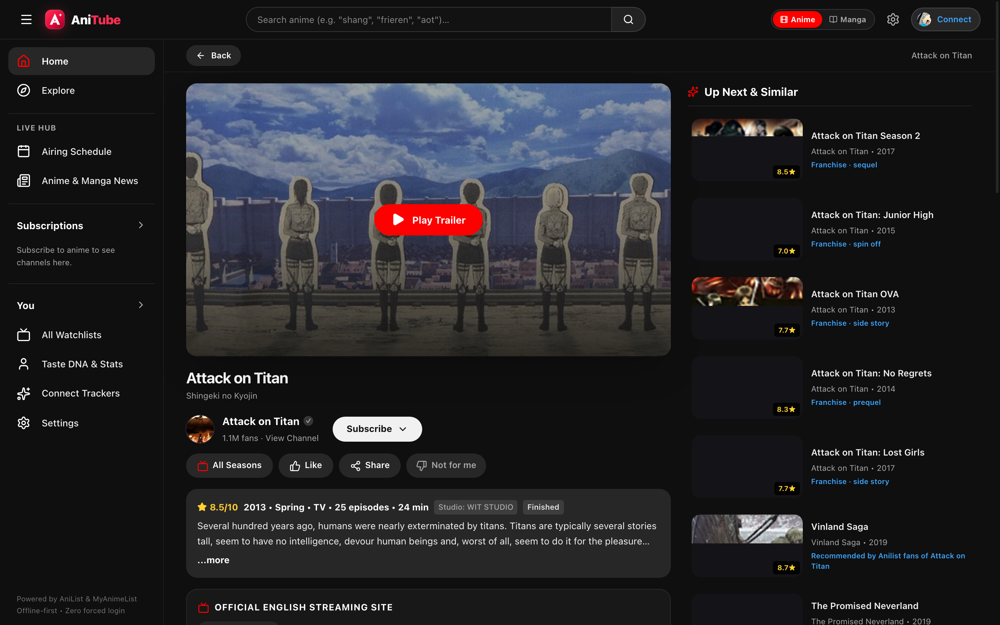
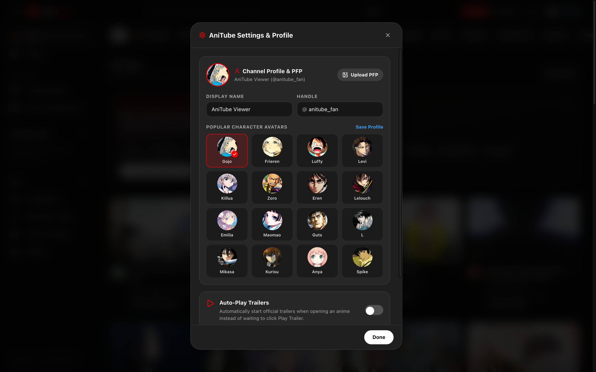
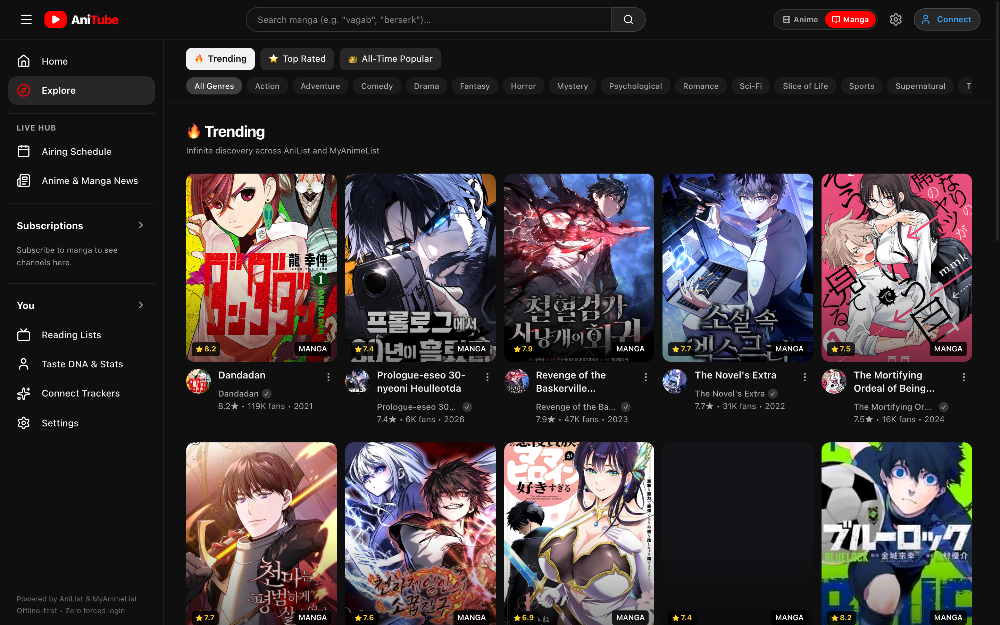

<div align="center">

# AniTube

**A YouTube-Inspired Anime & Manga Discovery, Franchise Channel, and Recommendation App**

Built with React, TypeScript, Tailwind CSS v4, and Capacitor Android — bringing YouTube's dark `#0F0F0F` AMOLED interface, infinite discovery feeds, franchise channels, and community-backed recommendation algorithms to Web & Android with zero forced login.

[](https://harshtheotaku.github.io/anitube/)
[](https://github.com/harshtheotaku/anitube/actions/workflows/build.yml)
[](https://github.com/harshtheotaku/anitube/actions/workflows/deploy-pages.yml)
[](LICENSE)

[**Launch Web App**](https://harshtheotaku.github.io/anitube/) · [**Download Android APK via Releases / Actions**](https://github.com/harshtheotaku/anitube/actions) · [**Report an Issue**](https://github.com/harshtheotaku/anitube/issues)

</div>

---

## Visual Tour

### Desktop Web — Infinite 16:9 Home Feed
Pure `#0F0F0F` AMOLED theme with category filter chips, infinite scrolling personalized recommendations, verified anime franchise channels, and crisp 16:9 artwork framing.


### Anime Franchise Channels (All Seasons in One Channel)
Every anime & manga series acts like a dedicated YouTube Channel — complete with banner art, `@handle`, subscriber count, bio `...more`, 5-list Subscribe picker, and chronological **Watch Order (Oldest)** / **Latest** / **Top Rated** season tabs.


### Watch Page & Multi-Source Community Recommendations
On-demand trailer playback (with optional **Auto-Play Trailers** setting), inline expandable synopsis, 5-list subscription status picker, **Up Next & Similar** community recommendations (AniList + MyAnimeList `/userrecs` + Season 1 prequel inheritance + Reddit consensus pairings), and official streaming links.



### YouTube Comments & Pinned Spoiler-Free MAL Reviews
Write permanent device-local notes & comments on any anime or manga, with a real **spoiler-free MyAnimeList review pinned right at the top** of the Comments thread.


### Custom Channel Profile & Popular Character Avatars
Personalize your display name, `@handle`, custom uploaded photo, or pick from 16 built-in official anime character avatars (**Gojo, Frieren, Luffy, Levi, Killua, Zoro, Eren, Lelouch, Emilia, Maomao, Guts, L, Mikasa, Kurisu, Anya, Spike**) in Settings.



### Dedicated Manga Mode (`4:5` Portrait Covers & 2-Column Mobile Grid)
Switch seamlessly between **Anime (`16:9`)** and **Manga (`4:5` portrait covers)** with separate watch/read progress, genres, and recommendation profiles. On Android/mobile, Manga automatically lays out **2 cards per row** for fast browsing.

<p align="center">
  
  &nbsp;&nbsp;
  
  &nbsp;&nbsp;
  
</p>

<details>
<summary>Desktop Manga 5-Column Portrait Grid</summary>



</details>

---

## Key Features

- **Franchise Channel Metaphor (`ChannelView` & `franchise.ts`):**
  - Channel names on cards and watch pages represent the **Anime/Manga franchise** rather than only the animation studio, grouping prequels, sequels, OVAs, movies, and spin-offs into one unified YouTube-style channel (`Seasons & Videos`, `Similar Channels`, `About`).
- **Community-Backed Recommendation Engine (`recommender.ts`):**
  - Blends **AniList Community Recommendations**, **MyAnimeList `/userrecs` fan votes** (with Season 1 prequel inheritance for multi-season franchises), **Franchise Relations**, and **Curated Reddit / Editorial affinity graphs**.
  - Multi-dimensional taste vector weighting niche tags, studios, genres, and formats paired with MMR diversification and infinite `IntersectionObserver` pagination without repeats.
- **Per-Tab Independent Search Bars & Smart Partial Match (`search.ts`):**
  - Every tab (`Home`, `Explore`, `Subscriptions`, `Schedule`, `News`, `You`) retains its **own independent search query** instead of leaking one global search term across tabs.
  - Supports instant partial prefixes and aliases (`"shang"` -> *Shangri-La Frontier*, `"aot"`, `"jjk"`, `"fmab"`) powered by MAL prefix, Shikimori, and AniList batch hydration.
- **Mobile-First Navigation & Full-Width Mobile Search (`TopBar.tsx`, `YouView.tsx`):**
  - Mobile top bar keeps **only the AniTube logo and a wide search bar**; Anime/Manga mode switch, **Schedule**, **News**, **Connect Account**, and **Settings** live cleanly in the **You** hub and bottom bar.
- **Live Broadcast Schedule & Illustrated News (`ScheduleView.tsx`, `NewsView.tsx`):**
  - 7-day official airing countdowns powered by AniList plus illustrated industry news from MyAnimeList News and Anime News Network.
- **Offline-First Storage & One-Click Tracker Import (`library.ts`, `trackers.ts`):**
  - Works immediately with **zero forced login**. Optionally connect an **AniList** username/token, **MyAnimeList** username/XML export, or local Google profile snapshot.
- **Pull-to-Refresh Recommendations & Forever Comments (`CommentsSection.tsx`, `reviews.ts`):**
  - Pulling down / scrolling upward at the top of the Home feed refreshes recommendations with fresh unseen picks instead of repeating top cards.
  - Persistent YouTube-style comments saved locally with a pinned spoiler-free review fetched from MyAnimeList (`reviews.ts`) and customizable character avatars (`profile.ts`).
- **Native Android Back Navigation & Viewport Lock (`MainActivity.java`):**
  - Android hardware/gesture back steps backward cleanly through modals, watch pages, franchise channels, and tabs before exiting on Home; WebView pinch/overview zoom is locked at native 1.0x mobile scale.

---

## Quick Start & Installation

### 1. Use Online (GitHub Pages)
Open the live web app directly in any desktop or mobile browser:
> **https://harshtheotaku.github.io/anitube/**

*(Optional: Add to Home Screen / Install PWA in Chrome or Safari for a fullscreen app feel.)*

---

### 2. Install on Android (APK via USB Debugging / Sideload)

#### Option A: Download prebuilt APK from GitHub Actions
1. Go to the [**Actions**](https://github.com/harshtheotaku/anitube/actions) tab on GitHub and click the latest **Build Web & Android** run.
2. Download the **`anitube-debug-apk`** artifact and install it on your Android device (Android 8.0 / minSdk 26+).

#### Option B: Build & Install via USB Debugging (`adb`)
**Prerequisites:** Node.js 22+, Java 21, Android SDK (`ANDROID_HOME` configured), and USB Debugging enabled on your phone.

```bash
git clone https://github.com/harshtheotaku/anitube.git
cd anitube

# Install dependencies & build static web bundle
npm install
npm run build

# Sync assets into the native Capacitor Android project
npx cap sync android

# Compile debug APK & install over USB
cd android
./gradlew assembleDebug
adb install -r app/build/outputs/apk/debug/app-debug.apk
```

---

### 3. Run Locally or Self-Host on Vercel

```bash
git clone https://github.com/harshtheotaku/anitube.git
cd anitube
npm install
npm run dev
```

- **Local Development (`http://localhost:5173`):** Includes Vite dev proxy rules (`/proxy/mal/*` and `/proxy/ann/*`) in [`vite.config.ts`](vite.config.ts).
- **Vercel Hosting:** Pre-configured with [`vercel.json`](vercel.json) rewrites so all MAL/ANN endpoints work serverlessly.
- **GitHub Pages Hosting:** Built with `GITHUB_PAGES=true npm run build` via [`.github/workflows/deploy-pages.yml`](.github/workflows/deploy-pages.yml) and automatically falls back cleanly to CORS-enabled APIs (`platform.ts`).

---

## Architecture

```text
anitube/
├── .github/workflows/
│   ├── build.yml                # CI: builds TypeScript + Vite bundle & compiles Android APK
│   └── deploy-pages.yml         # CD: builds and deploys live website to GitHub Pages
├── android/                     # Capacitor Android native wrapper (com.anitube.app)
├── docs/screenshots/            # Promo captures from Web & Mobile
├── src/
│   ├── components/
│   │   ├── AnimeCard.tsx        # 16:9 Anime & 4:5 Manga card + franchise channel trigger
│   │   ├── BottomNav.tsx        # Mobile 5-tab navigation bar
│   │   ├── ChannelView.tsx      # Franchise channel page (banner, handle, all seasons, tabs)
│   │   ├── CommentsSection.tsx  # Persistent YouTube comments + pinned spoiler-free MAL review
│   │   ├── DetailView.tsx       # Trailer watch page, 5-list Subscribe, Up Next recommendations
│   │   ├── ExploreView.tsx      # Infinite Trending / Top Rated / Seasonal / Genre discovery
│   │   ├── HomeView.tsx         # Infinite "For You" feed, pull-to-refresh & inline Home search
│   │   ├── ListView.tsx         # Subscriptions manager with story channels & progress steppers
│   │   ├── NewsView.tsx         # Illustrated anime & manga news feed
│   │   ├── ScheduleView.tsx     # 7-day live airing countdowns
│   │   ├── SettingsModal.tsx    # Profile/PFP picker, auto-play trailer toggle & cache controls
│   │   ├── Shelf.tsx            # Horizontal recommendation shelves
│   │   ├── Sidebar.tsx          # Collapsible YouTube navigation & subscribed channels
│   │   ├── Skeleton.tsx         # Responsive 16:9 & 4:5 loading skeletons
│   │   ├── TopBar.tsx           # Per-tab search bar + desktop mode/settings controls
│   │   ├── TrackersModal.tsx    # AniList, MyAnimeList, Google profile & XML/JSON import
│   │   └── YouView.tsx          # Mobile control hub (Anime|Manga, Schedule, News, DNA stats)
│   └── services/
│       ├── anilist.ts           # AniList GraphQL client (Anime, Manga, Schedule, hydration)
│       ├── animeStore.ts        # Local metadata & artwork store
│       ├── comments.ts          # Forever-saved per-title localStorage comment store
│       ├── franchise.ts         # Franchise name normalization & multi-season relation walker
│       ├── jikan.ts             # Jikan REST fallback
│       ├── library.ts           # Offline-first reactive persistence (localStorage)
│       ├── news.ts              # MAL News & ANN RSS aggregator with artwork enrichment
│       ├── platform.ts          # Runtime environment resolver (Capacitor / Proxy / Static Pages)
│       ├── profile.ts           # User profile store + 16 official character PFP presets
│       ├── recommender.ts       # Multi-source community vector, refresh rotation & MMR engine
│       ├── reviews.ts           # Spoiler-free MyAnimeList / Jikan / AniList pinned review fetcher
│       ├── search.ts            # Partial-word & acronym smart search engine
│       ├── settings.ts          # User preference persistence
│       └── trackers.ts          # AniList, MAL, token & XML export importers
├── capacitor.config.ts          # CapacitorHttp enabled for native CORS-free networking
├── vercel.json                  # Production proxy rewrites
└── vite.config.ts               # Dual-target config (Root / Vercel / GitHub Pages subpath)
```

---

## Tech Stack

- **Frontend:** React 18, TypeScript 7, Tailwind CSS v4, Lucide Icons, HLS.js
- **Build & Tooling:** Vite 8
- **Mobile Runtime:** Capacitor 8 Android (`CapacitorHttp` native networking)
- **APIs & Metadata:** AniList GraphQL, MyAnimeList, Shikimori, Anime News Network RSS, Jikan

---

## License

Released under the [MIT License](LICENSE).
